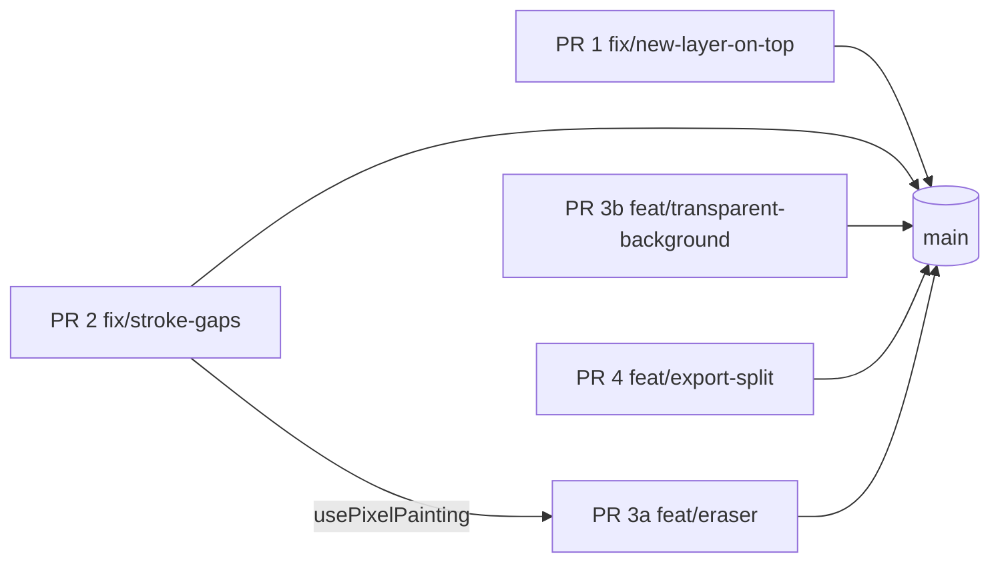

# Critique P1 Fixes Implementation Plan

> **For agentic workers:** REQUIRED SUB-SKILL: Use superpowers:subagent-driven-development (recommended) or superpowers:executing-plans to implement this plan task-by-task. Steps use checkbox (`- [ ]`) syntax for tracking.

**Goal:** Fix the four P1 issues from the 2026-10-30 Impeccable critique (`.impeccable/critique/2026-10-30T22-11-50Z__src-app.md`), one PR per issue:
1. New layers are hidden behind Background.
2. Fast strokes leave gaps.
3. There is no eraser and no transparent background. This ships as two PRs, 3a and 3b, to stay under AGENTS.md's ~20-file limit.
4. Export defaults work against game assets.

**Architecture:** Each fix puts its rule in a pure `.ts` module with Vitest tests (`layerEdits`, `strokeLine`, `editorTools`, `editorKeyboardGuards`, `exportScale`, `exportPreferences`). Hooks call those modules, and `.tsx` files only render. No PR changes the stored data format.

**Tech Stack:** Next.js 16, React 19, TypeScript, Vitest, Pointer Events (`getCoalescedEvents`), Canvas 2D, Dexie.

**Spec:** the critique snapshot above, plus Hugo's decision on 2026-10-31 for PR 4 ("split by intent"). That decision amends `docs/superpowers/specs/2026-10-30-shareable-exports-design.md`; PR 4 edits that spec.

## Global Constraints

- Follow `AGENTS.md`:
  - `.tsx` files are presentation only. Behaviour goes in `useX.ts`, classes in `X.style.ts` via `cx()`, types in `X.type.ts` (`I`/`T` prefixes).
  - All copy goes in `src/content` (typed in `content.type.ts`).
  - Code in `shared` must not import from `editor` or `gallery`.
- **One branch per PR**, created from a freshly fetched `origin/main` (`fix/<name>` or `feat/<name>`). Each PR stays at ≤ ~20 files.
- Every PR must pass `npm run lint`, `npm run typecheck`, `npm test` and `NEXT_DIST_DIR=.next-verify npm run build` before review.
- Never touch `.next`, and never stop the dev server on :3000. For smoke tests, run `npm run dev -- -p <port>` from the PR's worktree, on ports 3101–3105.
- Layer order: `layers[0]` is the **topmost** layer (`visibleCompositePixelCounts.ts:6`, the renderer and the bucket fill all agree).
- `TRANSPARENT_PIXEL_INDEX = 255` (`artworkService.ts:58`). Any index ≥ `palette.length` draws nothing.
- Pressed states never use the accent (DESIGN.md). Use the IconButton pressed classes (`surface-strong` + `ring-control-border`).
- Export scales stay `[1, 4, 8, 16, 32]`, the cap stays 4096 px, and both localStorage keys keep their names.

## Review Focus

1. **Adding a layer when the active layer is not the top one.** The new layer must sit directly above the active layer, not at index 0 and not at the bottom. (PR 1 test.)
2. **A stroke that leaves the canvas and comes back.** The cells on the canvas along the path are painted and nothing is written outside it. A stroke that starts off-canvas still paints nothing. (PR 2 clipping test + smoke.)
3. **Right-click while the eraser is on.** It erases too: the eraser ignores color slots. (PR 3a smoke, Step 5.)
4. **Pressing E while typing in a text field (rename layer, title).** The key must not be claimed. (PR 3a guard test.)
5. **A transparent artwork exported at ×1 with the strip off.** The result is a PNG of exactly W×H with alpha 0 everywhere, and the gallery thumbnail isn't blank-white. (PR 3b + PR 4 smoke.)

## PR order and dependencies

PRs 1, 2, 3b and 4 touch separate files and run in parallel. PR 3a edits `usePixelPainting.ts` after PR 2, so it branches from `main` once PR 2 has merged. If Hugo wants it sooner, it stacks on `fix/stroke-gaps` with that branch as the PR base.

---

## PR 1: New layers go directly above the active layer (`fix/new-layer-on-top`)

**Files:**
- Modify: `src/features/editor/logic/layerEdits.ts`, `layerEdits.test.ts`
- Modify: `src/features/editor/hooks/useArtworkLayers.ts:89-113`
- Add: this plan file (`docs/superpowers/plans/2026-10-31-critique-p1-fixes.md`)

**Interfaces:**
- Produces: `insertLayerAbove(layers: IArtworkLayer[], activeLayerId: string, layer: IArtworkLayer): IArtworkLayer[]`. It returns a new array and never mutates its input.

- [ ] **Step 1: Write failing tests** in `layerEdits.test.ts`, in `describe("insertLayerAbove")`:
  - `[A*, B]` (A active) gives `[N, A, B]`.
  - `[A, B*]` gives `[A, N, B]` (N goes in front of B, behind A).
  - An unknown active id gives `[N, A, B]`.
  - The input array is unchanged (`expect(input).toEqual([A, B])`).
- [ ] **Step 2: Run** `npx vitest run src/features/editor/logic/layerEdits.test.ts`. Expected: FAIL, `insertLayerAbove` is not exported.
- [ ] **Step 3: Implement** `insertLayerAbove` (splice at `findIndex(active)`, or at `0` when the id isn't found). In `addLayer`, replace `[...prev.layers, nextLayer]` with `insertLayerAbove(prev.layers, prev.activeLayerId, nextLayer)` and change the doc comment to "Adds an empty layer directly above the active layer". Leave `copyLayer` alone: its `splice(idx, 0, …)` already puts the copy in front of its source.
- [ ] **Step 4: Run** the test file again. Expected: PASS.
- [ ] **Step 5: Smoke** on :3101 with a 32×32 artwork:
  1. Add layer. "Layer 2" is listed above Background and active.
  2. Draw. The stroke is visible on the canvas.
  3. Export ×1. The stroke is in the PNG.
  4. Duplicate Background. The copy sits directly above it.
- [ ] **Step 6: Commit** `fix(editor): add new layers above the active layer`.

## PR 2: Continuous strokes (`fix/stroke-gaps`)

**Files:**
- Create: `src/features/editor/logic/strokeLine.ts`, `strokeLine.type.ts`, `strokeLine.test.ts`
- Modify: `src/features/editor/hooks/usePixelPainting.ts` (the `onMove` handler at :110-157 and the stroke start at :338-351)

**Interfaces:**
- Produces: `IGridPoint { x: number; y: number }` (in `strokeLine.type.ts`).
- Produces: `cellsOnLine(from: IGridPoint, to: IGridPoint): IGridPoint[]`. This is integer Bresenham, includes both ends, and is ordered from `from` to `to`.
- Produces: `cellsInBounds(cells: IGridPoint[], width: number, height: number): IGridPoint[]`.

- [ ] **Step 1: Write failing tests** in `strokeLine.test.ts`:
  - `(0,0)→(3,0)`: 4 cells, x = 0..3.
  - `(0,0)→(3,3)`: 4 diagonal cells.
  - `(0,0)→(1,3)` (steep): 4 cells, each y exactly once, |Δx| ≤ 1 between neighbours.
  - `(3,1)→(0,1)`: starts at (3,1) and ends at (0,1).
  - `(2,2)→(2,2)`: `[{x:2,y:2}]`.
  - `cellsInBounds` on `(-2,0)→(2,0)` with width 2: `[{0,0},{1,0}]`.
  - Length is `max(|Δx|,|Δy|)+1` for `(0,0)→(999,0)`.
- [ ] **Step 2: Run** `npx vitest run src/features/editor/logic/strokeLine.test.ts`. Expected: FAIL (module missing).
- [ ] **Step 3: Implement `strokeLine.ts`.** Then in `usePixelPainting`:
  - Add `lastCell = useRef<IGridPoint | null>(null)`. Set it on stroke start to the down cell, and clear it in `endStroke`.
  - In `onMove`, take samples from `e.getCoalescedEvents?.()`, falling back to `[e]` when the result is missing or empty.
  - For each sample, convert it with `screenToWorldCoordinates`. Paint `cellsInBounds(cellsOnLine(lastCell, cell).slice(1), art.width, art.height)`: drop the start cell **before** clipping, because it's already painted and may itself be off-canvas. Then set `lastCell = cell`, even when that cell is off-canvas.
  - Compute the palette index once per event.
  - Call `onPixelsChanged()` at most once per event.
  - Move the existing per-pixel write and delta push into a local `paintIndex(index)` closure shared with the stroke start.
  - Bucket fill is unchanged.
- [ ] **Step 4: Run** the tests, then `npm test`. Expected: PASS.
- [ ] **Step 5: Smoke** on :3102:
  - On a 32×32 canvas, one fast diagonal drag paints a continuous line with no gaps.
  - On a 1000×1000 canvas, zoomed out, a long drag stays responsive (check with the Performance panel or by feel).
  - A drag that leaves the canvas and comes back paints only on the canvas.
  - Undo removes the whole stroke in one step.
- [ ] **Step 6: Commit** `fix(editor): fill gaps between pointer samples in brush strokes`.

## PR 3a: Eraser tool (`feat/eraser`), after PR 2 merges

**Files:**
- Modify: `src/features/editor/logic/editorTools.ts`, `editorTools.type.ts`, `editorTools.test.ts`
- Modify: `src/features/editor/logic/editorKeyboardGuards.ts`, `editorKeyboardGuards.type.ts`, `editorKeyboardGuards.test.ts`
- Modify: `src/features/editor/hooks/useEditorKeyboardShortcuts.ts`, `.type.ts`
- Modify: `src/features/editor/hooks/usePixelPainting.ts`, `.type.ts`
- Modify: `src/features/editor/components/useEditorWorkspace.ts`, `EditorWorkspace.tsx`, `EditorActionsBar.tsx`, `EditorActionsBar.type.ts`
- Create: `public/icons/eraser.svg` (24 grid, 1.5 stroke, `currentColor`, so `publicIcons.test.ts` passes)
- Modify: `src/features/shared/constants/publicIcons.ts`, `src/content/editor.ts`, `src/content/help.ts`, `src/content/content.type.ts`, `src/content/help.test.ts`

**Interfaces:**
- `IEditorToolState` gains `eraserMode: boolean`, and `TEditorToolAction` gains `"toggleEraser"`.
- `TEditorShortcut` gains `"toggleEraser"`. The help `effect` union gains `"toggleEraser"`.
- `IUsePixelPaintingParams` gains `eraserMode?: boolean`.
- `IUseEditorKeyboardShortcutsParams` gains `onToggleEraser: () => void`.

- [ ] **Step 1: Write failing tests.**
  - In `editorTools.test.ts`:
    - From the brush, `toggleEraser` turns the eraser on and every other flag off.
    - Toggling it again goes back to the brush.
    - `toggleBucket`, `togglePan` and `togglePicker` from the eraser turn it off.
    - `togglePicker` from the eraser, then `pickApplied`, returns to the **brush**. Picking a color means you want to paint.
  - In `editorKeyboardGuards.test.ts`:
    - `e` and `E` with no modifiers give `"toggleEraser"`.
    - Ctrl+E, ⌘+E and Alt+E give `null`.
    - `e` while the target is a text field gives `null`.
- [ ] **Step 2: Run** both test files. Expected: FAIL.
- [ ] **Step 3: Implement.**
  - `applyToolAction` gets a `toggleEraser` case. `BRUSH` gets `eraserMode: false`.
  - `editorShortcutForKey` maps `e` with no modifiers to `"toggleEraser"`.
  - In `usePixelPainting`, keep `eraserModeRef` in sync and paint `TRANSPARENT_PIXEL_INDEX` instead of `paletteIndexForButtons(...)` when it's on. That covers both mouse buttons. The hidden-layer guard is unchanged.
  - Wire `eraserMode` and `toggleEraserMode` through `useEditorWorkspace` and `EditorWorkspace`.
  - Add an eraser `IconButton` after the bucket button in `EditorActionsBar`, with `pressed={eraserMode}`.
  - Copy:
    - `toolbar.eraser = { label: "Eraser", shortcut: "E" }`
    - Help shortcut `{ action: "Erase pixels (make them transparent)", combo: { key: "e" }, effect: "toggleEraser" }`
    - Add a `toggleEraser` case to the switch in `help.test.ts`, next to `toggleGrid`.
- [ ] **Step 4: Run** `npm test`. Expected: PASS, including `help.test.ts` "documents every effect".
- [ ] **Step 5: Smoke** on :3103:
  - With the eraser on, dragging over Background shows the checkerboard.
  - Right-drag also erases.
  - E toggles the eraser; E inside the layer-rename field types an "e".
  - Undo restores the erased pixels.
  - Alt-pick while erasing returns to the brush.
  - Export ×1 has alpha 0 where you erased.
- [ ] **Step 6: Commit** `feat(editor): eraser tool (E)`.

## PR 3b: Transparent background on create (`feat/transparent-background`)

**Files:**
- Modify: `src/features/shared/artwork/artworkService.ts:168-215`, `artworkService.type.ts`, `artworkService.test.ts`
- Modify: `src/features/gallery/hooks/useCreateArtworkForm.ts`, `.type.ts`
- Modify: `src/features/gallery/components/CreateArtworkModal.tsx`, `.style.ts`
- Modify: `src/content/gallery.ts`, `src/content/content.type.ts`

**Interfaces:**
- `ICreateArtworkInput.backgroundColor: string | null`, where `null` means transparent. Update every caller; `tsc` lists them, including tests in `useGalleryStore.test.ts` and `artworkSyncStore.test.ts`.
- The form hook adds `transparentBackground: boolean` and `setTransparentBackground(on: boolean): void`.

- [ ] **Step 1: Write failing tests** in `artworkService.test.ts`:
  - `createArtwork({ …, backgroundColor: null })` gives every pixel of `layers[0]` equal to `TRANSPARENT_PIXEL_INDEX`, a palette equal to `DEFAULT_PALETTE` (nothing appended), and a layer named `shared.artwork.backgroundLayer`.
  - The existing hex cases still pass.
- [ ] **Step 2: Run** `npx vitest run src/features/shared/artwork/artworkService.test.ts`. Expected: FAIL.
- [ ] **Step 3: Implement.**
  - In `createArtwork`, a `null` background skips hex validation and the palette append, and fills with `TRANSPARENT_PIXEL_INDEX`.
  - In the modal, add a shared `Switch` "Transparent background" above `ColorField`. When it's on, `ColorField` is disabled and the hook submits `backgroundColor: null`. Disabled colour validation never blocks submit.
  - Split `gallery.create.hint` into a size hint (under the size fieldset) and a background hint ("New pixels use this color. Turn on Transparent background for sprites.").
- [ ] **Step 4: Run** `npm test`. Expected: PASS.
- [ ] **Step 5: Smoke** on :3104:
  - Create a 16×16 artwork with a transparent background. The editor shows the checkerboard.
  - Draw, then export ×1 with the strip off. The PNG is 16×16 with alpha 0 outside the stroke.
  - The gallery thumbnail renders, transparent over the thumbnail well.
- [ ] **Step 6: Commit** `feat(gallery): transparent background option for new artworks`.

## PR 4: Separate download and share settings (`feat/export-split`)

Decision (Hugo, 2026-10-31):
- **Download PNG** is the primary action, for game assets. It defaults to ×1 with no strip and uses the panel's size and strip controls, both remembered.
- **Share** always uses the share rule the gallery already uses: the smallest scale reaching 1024 px, with the strip on. The editor and gallery now share one rule.
- Trade-off: you can no longer share without the strip from the editor. That matches the gallery's existing Share.

**Files:**
- Modify: `src/features/shared/artwork/exportScale.ts`, `exportScale.type.ts`, `exportScale.test.ts`
- Modify: `src/features/shared/artwork/exportPreferences.ts`, `exportPreferences.test.ts`
- Modify: `src/features/gallery/components/useArtworkCard.ts:37-44`
- Modify: `src/features/editor/components/EditorSettingsDrawer/hooks/useImportExportPanel.ts`, `useImportExportPanel.type.ts`
- Modify: `src/features/editor/components/EditorSettingsDrawer/EditorSettingsImportExportPanel.tsx`, `.type.ts`, `.style.ts`
- Create: `src/features/shared/components/pressedState.style.ts`. Modify `IconButton.style.ts` to import from it (the pressed classes move there unchanged).
- Modify: `src/content/editor.ts`, `src/content/content.type.ts`
- Modify: `docs/superpowers/specs/2026-10-30-shareable-exports-design.md` (the "Defaults" and "Credit on by default" lines)

**Interfaces:**
- `resolveExportScale(stored, art, stripHeight)` falls back to `1` instead of `defaultExportScale`. ×1 is always allowed: 1000 + an 80 px strip is less than 4096.
- `shareExportOptions(art: IExportArtSize): { scale: TExportScale; credit: true }`, which returns `defaultExportScale(art, creditStripHeight)`. It is used by `useArtworkCard` and `useImportExportPanel`.
- `parseExportCredit(raw)` is `raw === "on"`. `readStoredExportCredit` returns `false` on a storage error.
- The panel props replace `onExportPng` with `onDownloadPng`, and add `shareSizeLabel: string` (e.g. "1024 × 1106 with the PixelHB strip").

- [ ] **Step 1: Write failing tests.**
  - In `exportScale.test.ts`:
    - `resolveExportScale(null, 32×32, noStrip)` gives `1`.
    - A stored `32` on a 500×500 artwork gives `1`.
    - A stored `8` on a 32×32 artwork gives `8`.
    - `shareExportOptions(32×32)` gives `{ scale: 32, credit: true }`.
    - `shareExportOptions(1000×1000)` gives `{ scale: 1, credit: true }`.
  - In `exportPreferences.test.ts`:
    - `parseExportCredit(null)` and `parseExportCredit("garbage")` give `false`.
    - `parseExportCredit("on")` gives `true`.
    - A throwing storage reads as `false`.
- [ ] **Step 2: Run** both test files. Expected: FAIL.
- [ ] **Step 3: Implement.**
  - **Hook:**
    - `usePreparedPng` renders only the share PNG (`shareExportOptions(artwork)`).
    - `downloadPng` always calls `exportArtworkAsPng(artwork, { scale, credit })`. That removes the "reuse the prepared PNG" branch, since the download and share settings no longer match.
    - Analytics: `export_png { scale, credit: drawn }`, and `share` with the share scale.
  - **Panel:**
    - "Download PNG" section: size chips, then the strip `Switch`, then a **primary** "Download PNG" button.
    - "Share" section: one hint line with `shareSizeLabel`, then an **outline** Share button.
    - An outline "Download JSON (editable)" button at the end.
    - Scale chips: `variant="ghost"` plus `pressedState` classes, never `primary`.
  - **Copy:**
    - Drop the `export.title` heading and the four-times-"export" wording.
    - Settings menu: `export: { label: "Export & share", hint: "PNG, JSON or share" }`.
    - Panel hint: "Download a PNG for your game or a JSON you can edit later; Share sends a larger image with the PixelHB strip."
  - **Spec:** update the defaults section to match.
- [ ] **Step 4: Run** `npm test`, `npm run lint`, `npm run typecheck`. Expected: PASS.
- [ ] **Step 5: Smoke** on :3105 with localStorage cleared:
  - On a 32×32 artwork, Download PNG gives `title.png`, exactly 32×32, with no strip.
  - Share produces 1024×1106 with the strip. In headless, the clipboard or download fallback is enough.
  - Choosing ×8 and turning the strip on persists after a reload.
  - Gallery Share is unchanged.
  - Check the pressed chip in light and dark: it's neutral, not amber.
- [ ] **Step 6: Commit** `feat(export): split download and share settings; download defaults to ×1 without strip`.
