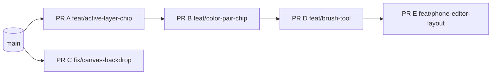

# Critique Round 2 Implementation Plan

> **For agentic workers:** REQUIRED SUB-SKILL: Use superpowers:subagent-driven-development (recommended) or superpowers:executing-plans to implement this plan task-by-task. Steps use checkbox (`- [ ]`) syntax for tracking.

**Goal:** Fix the four P1 issues and the P2 Brush/tool-model issue from the 2026-10-31 Impeccable critique (`.impeccable/critique/2026-10-31T14-45-19Z__src-app.md`), one PR each:
- **A:** the active layer is visible outside the Layers drawer, and a warning appears when a stroke is hidden behind another layer.
- **B:** a neutral two-color chip replaces the amber "Primary" button, and swatch slots get a marker that doesn't rely on hue.
- **C:** the checkerboard only covers the artwork, aligned to pixels, with a canvas edge. Thumbnails and previews show transparency.
- **D (P2):** an explicit Brush tool, picking a swatch turns the eraser off, a toolbar Export button, and new shortcuts.
- **E:** a phone editor built for thumbs: tools in a bottom bar, palette fit, layer-name overlap fixed, no title autofocus on touch.

**Architecture:** Rules live in pure `.ts` modules with Vitest tests:
- `strokeOcclusion`
- `canvasBackdrop`
- `editorTools`
- `editorKeyboardGuards`
- `modalAutofocus`

Hooks call these modules, and `.tsx` files only render. Layout changes (PR E) go through CSS grid areas, so each control is rendered exactly once.

**Tech Stack:** Next.js 16, React 19, TypeScript, Tailwind v4 tokens, Vitest, Canvas 2D, dnd-kit.

**Spec:** the critique snapshot above, plus Hugo's answers on 2026-10-31:
- Priority is editor state first.
- For Layers, build the chip and the warning only, with **no** docked panel.
- Scope covers all priority issues, so the P2 Brush work is included.

## Global Constraints

- **Follow `AGENTS.md`:**
  - `.tsx` is presentation only.
  - Behaviour goes in `useX.ts`, classes in `X.style.ts` via `cx()`, and types in `X.type.ts` (`I`/`T` prefixes).
  - All copy goes in `src/content`, typed in `content.type.ts`.
  - `shared` never imports from `editor` or `gallery`.
- **Branches:** each PR gets its own branch, created from freshly fetched `origin/main`, or **stacked** where the dependency graph says so. Keep each PR to about 20 files or fewer.
- **Checks:** before review, every PR passes `npm run lint`, `npm run typecheck`, `npm test` and `NEXT_DIST_DIR=.next-verify npm run build`.
- **Workspace hygiene:**
  - Never touch `.next` or the dev server on :3000. Smoke-test on ports 3111–3115.
  - `next dev` and `typegen` rewrite `AGENTS.md` and `next-env.d.ts`. Revert those, never commit them, and never run Prettier over files you didn't change.
- **Layers:** `layers[0]` is the topmost layer. `TRANSPARENT_PIXEL_INDEX = 255`, and any index at or beyond `palette.length` is transparent.
- **Accent:** DESIGN.md allows exactly one accent per theme. The accent never marks a pressed state or a mode switch. Pressed states use `pressedState` (`src/features/shared/components/pressedState.style.ts`).
- **Accessibility:**
  - Every control has an accessible name.
  - Targets are 40px, or 44px on coarse pointers.
  - Focus is visible.
  - Keyboard shortcuts never fire in text fields (`isTextEntryTarget`) or with Ctrl/⌘/Alt held, except the existing undo and redo.
- **No scroll-jacking:** only the canvas viewport may `preventDefault` wheel, touch or drag input.

## Review Focus

1. **A stroke that is only partly covered by a layer above.** No warning: the visible part is feedback enough. Only a fully covered stroke warns. (PR A test.)
2. **Switching theme while the editor is open.** The checkerboard and the canvas edge recolor without a reload. (PR C smoke.)
3. **Typing B, F, I, X, + or − in the layer-rename field or the title field.** Each types its character, and no tool changes. (PR B and PR D guard tests.)
4. **A 390×844 phone in landscape (844×390) and at 360px wide.** The bottom tool bar still fits on one row without horizontal scroll, and the canvas keeps at least 50% of the height. (PR E smoke.)
5. **A transparent 1000×1000 artwork zoomed fully out (scale 1).** The checkerboard stays at 8–16 screen px per square and render time doesn't regress visibly, so only the visible part of the checkerboard is drawn. (PR C test + smoke.)

## PR order

PRs A, B, D and E all edit `EditorActionsBar`, so they are **stacked** in that order, and each PR targets the branch before it. GitHub retargets each one to `main` as the PR below it merges. PR C touches only the canvas, thumbnails and previews, so it runs in parallel with A from `main`. **Merge order: A, B, D, E; C any time.**

---

## PR A: Active layer at a glance + hidden-stroke warning (`feat/active-layer-chip`)

**Files:**
- Create: `src/features/editor/logic/strokeOcclusion.ts`, `strokeOcclusion.test.ts`
- Create: `src/features/editor/components/ActiveLayerChip.tsx`, `.style.ts`, `.type.ts`, `useActiveLayerChip.ts`
- Modify: `src/features/editor/components/LayersDrawer/LayerPreview.type.ts`, `useLayerPreview.ts` (optional `revision`)
- Modify: `src/features/editor/components/EditorActionsBar.tsx`, `.type.ts`; `EditorWorkspace.tsx`; `useEditorWorkspace.ts` (`onCommitStroke` at :187)
- Modify: `src/content/editor.ts`, `src/content/content.type.ts`
- Add: this plan file

**Interfaces:**
- **Produces:** `isStrokeHidden(artwork: Pick<IArtwork, "layers" | "palette">, activeLayerId: string, pixelIndices: readonly number[]): boolean`.
  - It returns true when `pixelIndices` is non-empty and **every** index is covered by a visible layer above the active one (lower array index) whose pixel there is opaque (`< palette.length`).
  - It returns false when the active layer is topmost or isn't found.
- **Produces:** `IActiveLayerChipProps { layer: IArtworkLayer; palette: string[]; width: number; height: number; revision: number; pressed: boolean; onClick(): void }`.
- **`ILayerPreviewProps`** gains `revision?: number`, which is added to the `useMemo` deps.

- [ ] **Step 1: Write failing tests** in `strokeOcclusion.test.ts`, with three layers `[Top, Mid*, Bottom]` and a 2-entry palette:
  - Top is opaque at indices {0,1} and the stroke is {0,1}: `true`.
  - The stroke is {0,1,2} and Top is transparent at 2: `false` (partly visible).
  - Top is hidden (`visible: false`): `false`.
  - Top's pixel is `255`, or `>= palette.length`: not covering.
  - The active layer is topmost: `false`.
  - Empty indices: `false`.
  - An unknown active id: `false`.
- [ ] **Step 2: Run** `npx vitest run src/features/editor/logic/strokeOcclusion.test.ts`. Expected: FAIL (module missing).
- [ ] **Step 3: Implement.**
  - **`isStrokeHidden`:** for each index, walk `layers[0..activeIdx-1]` and stop at the first opaque pixel. It's O(indices × layers above), with no allocation.
  - **`onCommitStroke`:** after `pushCommand(cmd)`, if `isStrokeHidden(artwork, activeLayerId, cmd.deltas.map(d => d.index))`, call `showToast({ message: editor.toasts.strokeHidden, tone: "error", skipDuplicateActiveToast: true })`. This covers brush, eraser and bucket, because all three commit through it. Use `artworkRef`, or whatever the hook already uses to read the current artwork, so the callback doesn't go stale.
  - **`ActiveLayerChip`:**
    - It **replaces** the Layers `IconButton` in `EditorActionsBar`.
    - It shows a 24×24 `LayerPreview`, keyed by `revision = paintRevision`, over the `pixel-checkerboard` well, followed by the layer name, truncated at `max-w-[14ch]`.
    - It uses `pressedState` while the drawer is open, and a neutral outline otherwise.
  - **Copy:**
    - `toolbar.layers.chipLabel: (name) => \`Layers. Active layer: ${name}\``
    - `toasts.strokeHidden: "That stroke is behind another layer. Open Layers to move this layer up or hide the one above."`
- [ ] **Step 4: Run** `npm test`. Expected: PASS.
- [ ] **Step 5: Smoke** on :3111:
  1. The chip shows "Background" with a preview, and the preview updates after a stroke.
  2. Add a layer, then drag Background above it, close the drawer and paint: the toast appears once and the chip shows the active layer.
  3. Paint partly over the edge of an opaque area: no toast.
  4. Clicking the chip opens Layers. A screen reader announces the name.
- [ ] **Step 6: Commit** `feat(editor): active layer chip and hidden-stroke warning`.

## PR B: Neutral color-pair chip + non-hue slot markers (`feat/color-pair-chip`), stacked on A

**Files:**
- Create: `src/features/editor/components/ColorPairChip.tsx`, `.style.ts`, `.type.ts`, `useColorPairChip.ts`
- Modify: `src/features/editor/components/EditorActionsBar.tsx`, `.style.ts` (delete `slotToggle`), `.type.ts`, `useEditorActionsBar.ts`; `EditorWorkspace.tsx`
- Modify: `src/features/shared/components/ColorSwatch.tsx`, `ColorSwatch.style.ts`
- Modify: `src/features/editor/logic/editorKeyboardGuards.ts`, `.type.ts`, `.test.ts`; `src/features/editor/hooks/useEditorKeyboardShortcuts.ts`, `.type.ts`; `useEditorWorkspace.ts`
- Modify: `src/content/editor.ts`, `help.ts`, `content.type.ts`, `help.test.ts`; `DESIGN.md` (slot toggle section)

**Interfaces:**
- **Produces:** `IColorPairChipProps { primaryColor: string; secondaryColor: string; activeSlot: TColorSlot; onToggle(): void }`.
- `TEditorShortcut` gains `"switchSlot"`, and the help `effect` union gains `"switchSlot"`.
- `IUseEditorKeyboardShortcutsParams` gains `onSwitchSlot(): void`.

- [ ] **Step 1: Write failing tests** in `editorKeyboardGuards.test.ts`:
  - `x` and `X` with no modifiers give `"switchSlot"`.
  - Ctrl+X, ⌘+X and Alt+X give `null`, so cut keeps working.
  - A text target gives `null`.
- [ ] **Step 2: Run** the guard tests. Expected: FAIL.
- [ ] **Step 3: Implement.**
  - **`ColorPairChip`:**
    - Two 20px squares overlapping by 8px, with the active slot in front (top-left) and the other behind (bottom-right). Each square has a `ring-1 ring-control-border`.
    - The button uses the neutral outline/ghost style and **never** `variant="primary"`. 40px target, 44px on coarse pointers.
    - Clicking it calls `paletteUi.toggleActiveSlot`.
    - `aria-label` = `toolbar.colors.label(activeHex, otherHex)`, e.g. "Colors: painting with #1A1C2C, right-click paints #F4F4F4. Press X to switch." `title` = "Switch colors (X)".
  - Delete `toolbar.slot.*` and `slotToggle`, and remove `slotLabel`/`slotAriaLabel` from `useEditorActionsBar`.
  - **`ColorSwatch`** (comfortable density only) renders a corner marker ``:
    - primary: a 6px `bg-fg` square with `ring-1 ring-bg` at the top-left
    - secondary: the same at the bottom-right
    - both: both markers

    Rings are unchanged, and marker classes live in `ColorSwatch.style.ts` under `marker.{primary,secondary}`.
  - Wire **X** through `useEditorKeyboardShortcuts` to `toggleActiveSlot`.
  - Help row: `{ action: "Switch between your two colors", combo: { key: "x" }, effect: "switchSlot" }`.
  - **DESIGN.md:** the slot control is a neutral chip, and the accent is no longer used for it.
- [ ] **Step 4: Run** `npm test`. Expected: PASS, including `help.test.ts` "documents every effect" and `tokenContrast`.
- [ ] **Step 5: Smoke** on :3112:
  - The chip shows the real colors, and clicking it or pressing X swaps which one is in front.
  - The left click then paints the front color.
  - No amber fill appears in the toolbar, in light or dark.
  - Swatch markers are visible on `#EF7D57`, `#B13E53`, `#1A1C2C` and `#F4F4F4`, in both themes.
  - X in the layer-rename field types an "x".
- [ ] **Step 6: Commit** `feat(editor): neutral color pair chip and slot markers`.

## PR C: Checkerboard inside the artwork only, aligned to pixels (`fix/canvas-backdrop`), parallel with A

**Files:**
- Create: `src/features/editor/logic/canvasBackdrop.ts`, `canvasBackdrop.type.ts`, `canvasBackdrop.test.ts`
- Modify: `src/features/shared/artwork/canvasRender.ts`, `canvasRender.type.ts` (optional `{ clear?: boolean }`, default `true`)
- Modify: `src/features/editor/hooks/useCanvasEngine.ts` (render at :89, and `EDITOR_ROOT_CSS_VARS`)
- Modify: `src/features/editor/components/CanvasContainer.tsx`, `.style.ts` (remove the `checker` div and key)
- Modify: `src/app/globals.css`: the dark `--color-checker-light/dark` values
- Modify: `src/app/tokenContrast.test.ts`
- Modify: `src/features/editor/components/LayersDrawer/LayerPreview.style.ts` and the gallery card thumbnail style (`ArtworkCard.style.ts`): add a `pixel-checkerboard` background behind the image

**Interfaces:**
- **Produces:**
  - `checkerWorldSize(scale: number): number`, a power of two equal to `2 ** Math.ceil(Math.log2(8 / scale))`. Its on-screen size `scale × result` is always in `[8, 16)` CSS px.
  - `drawCanvasBackdrop(ctx, size: { width: number; height: number }, viewport: IViewportState, colors: { light: string; dark: string }, canvasCss: { w: number; h: number }): void`. It fills the artwork rectangle with light, then draws dark squares on the cells where `(cx + cy) % 2 === 1`. Only squares that intersect the visible world bounds (`getVisibleWorldBounds`) are drawn.
  - `drawCanvasEdge(ctx, size, viewport, color: string): void`. It strokes a 1 CSS px line just **outside** the artwork rectangle, snapped to `.5`.

- [ ] **Step 1: Write failing tests** in `canvasBackdrop.test.ts`:
  - `checkerWorldSize` gives 8 at scale 1, 4 at scale 3, 1 at scale 8, `0.5` at scale 16 and `0.25` at scale 40.
  - For every integer scale from 1 to 64, `scale × size` is ≥ 8 and < 16.
  - A fake `ctx` that records `fillRect` calls, at scale 16 with the viewport showing only a quarter of a 16×16 artwork, sees about a quarter of the dark squares (assert `< 0.3 ×` the full count).
- [ ] **Step 2: Run** the tests. Expected: FAIL.
- [ ] **Step 3: Implement.**
  - **`useCanvasEngine`:** `actx.clearRect` → `drawCanvasBackdrop` → `renderCanvas(actx, artwork, viewport, { clear: false })` → `drawCanvasEdge`. Colors come from `readRootCssColor` for `--color-checker-light`, `--color-checker-dark` and `--color-line-strong`, added to `EDITOR_ROOT_CSS_VARS`.
  - Make the render re-run on a theme change. Use the same dependency the grid colors would need; if none exists, add the resolved theme from the existing theme hook to the effect deps.
  - The `CanvasContainer` shell keeps its flat `bg-surface-muted`.
  - **Dark theme checker tokens:** raise them so `#1A1C2C` (the darkest Sweetie 16 color) reaches ≥ 3:1 against **both** checker tones while the two tones stay distinct. Add those two pairs to `tokenContrast.test.ts`. Light theme values are unchanged.
  - **Previews:** layer previews and gallery thumbnails get a `pixel-checkerboard` background on their image well.
- [ ] **Step 4: Run** `npm test`. Expected: PASS.
- [ ] **Step 5: Smoke** on :3113:
  - On a transparent 16×16 at 1440, the canvas edge is visible, the area outside the art is flat, and the checkerboard squares line up with the pixels at three zoom levels.
  - In dark theme, `#1A1C2C` strokes are visible.
  - Switching theme in Settings recolors the backdrop.
  - A transparent 1000×1000 zoomed out draws with no visible lag.
  - Thumbnails and layer previews show the checkerboard where pixels are transparent.
- [ ] **Step 6: Commit** `fix(editor): draw the checkerboard inside the artwork, aligned to pixels, with a canvas edge`.

## PR D (P2): Brush tool, swatch pick turns the eraser off, toolbar Export, shortcuts (`feat/brush-tool`), stacked on B

**Files:**
- Modify: `src/features/editor/logic/editorTools.ts`, `.type.ts`, `.test.ts`
- Modify: `src/features/editor/logic/editorKeyboardGuards.ts`, `.type.ts`, `.test.ts`; `src/features/editor/hooks/useEditorKeyboardShortcuts.ts`, `.type.ts`
- Modify: `src/features/editor/components/useEditorWorkspace.ts`, `EditorWorkspace.tsx`, `EditorActionsBar.tsx`, `.type.ts`
- Modify: `src/features/editor/components/EditorSettingsDrawer/EditorSettingsDrawer.tsx`, `.type.ts`, `hooks/useCanvasSizePanel.ts` (`initialView`)
- Modify: `src/content/editor.ts`, `help.ts`, `content.type.ts`, `help.test.ts`; `README.md` (shortcuts table)

**Interfaces:**
- `TEditorToolAction` gains `"selectBrush"`, which returns `BRUSH`.
- **Produces:** `toolsAfterSwatchPick(state: IEditorToolState): IEditorToolState`, which returns `BRUSH` when `eraserMode` is on and `state` otherwise.
- `TEditorShortcut` gains `"selectBrush" | "toggleBucket" | "togglePicker" | "zoomIn" | "zoomOut"`. The help `effect` union gains the same.
- `IEditorSettingsDrawerProps` gains `initialView?: TEditorSettingsView`.

- [ ] **Step 1: Write failing tests.**
  - `editorTools`:
    - `selectBrush` from each of eraser, bucket, pan and picker-armed gives `BRUSH`.
    - `toolsAfterSwatchPick` from the eraser gives `BRUSH`.
    - `toolsAfterSwatchPick` from the bucket keeps the bucket.
  - **Guards:**
    - `b` → selectBrush, `f` → toggleBucket, `i` → togglePicker.
    - `+` and `=` → zoomIn, and `-` → zoomOut, with no Ctrl or ⌘ (browser zoom stays the browser's).
    - With Ctrl, ⌘ or Alt held, each gives `null`.
    - A text target gives `null`.
- [ ] **Step 2: Run** both test files. Expected: FAIL.
- [ ] **Step 3: Implement.**
  - Add a Brush `IconButton` (`PUBLIC_ICONS.pencil`, label "Brush", shortcut "B") first in the tool group, pressed when no tool flag is on.
  - Wrap `onSwatchPick` in `useEditorWorkspace` so it applies `toolsAfterSwatchPick` through `runToolAction`.
  - Add an Export `IconButton` (`PUBLIC_ICONS.download`, label "Export & share") that opens the settings drawer with `initialView="importExport"`. `useCanvasSizePanel` initialises `settingsView` from `initialView ?? "menu"`. Back still returns to the menu.
  - Add the shortcut rows to Help and README. Tooltips show each key (`toolbar.bucket.shortcut = "F"`, and so on).
- [ ] **Step 4: Run** `npm test`. Expected: PASS.
- [ ] **Step 5: Smoke** on :3114:
  - B, F, I, + and − work.
  - Picking a swatch while erasing paints the next stroke.
  - The Export button opens straight to Export, and Back goes to the menu.
  - Typing b, f, i, + or − in the rename field types the character.
- [ ] **Step 6: Commit** `feat(editor): brush tool, export button and tool shortcuts`.

## PR E: Phone editor (`feat/phone-editor-layout`), stacked on D

**Files:**
- Create: `src/features/editor/components/EditorToolBar.tsx`, `.style.ts`, `.type.ts` (the tool group, moved out of `EditorActionsBar`)
- Modify: `EditorActionsBar.tsx`, `.style.ts`, `.type.ts` (keeps back, title, status, undo/redo, layer chip, export, settings); `EditorWorkspace.tsx`, `EditorWorkspace.style.ts`
- Modify: `ColorSelectionRow.tsx`, `.style.ts` (Edit palette shows its icon, with the label only from `sm`)
- Modify: `src/features/editor/components/LayersDrawer/SortableLayerItem.style.ts` (`layerName` gets `block min-w-0`, and its flex parent `min-w-0`)
- Create: `src/features/shared/logic/modalAutofocus.ts`, `modalAutofocus.test.ts`. Modify: `src/features/shared/components/useModal.ts:33-42`.

**Interfaces:**
- **Produces:** `IEditorToolBarProps`, the tool props moved out of `IEditorActionsBarProps`: brush, eraser, bucket, picker, pan, color pair, zoom, shift.
- **Produces:** `shouldAutofocusTarget(input: { coarsePointer: boolean; isTextEntry: boolean }): boolean`, which returns `!(coarsePointer && isTextEntry)`.

- [ ] **Step 1: Write failing tests** in `modalAutofocus.test.ts`: all four input combinations. Only coarse pointer with a text entry gives `false`.
- [ ] **Step 2: Run** the test. Expected: FAIL.
- [ ] **Step 3: Implement.**
  - **Workspace grid.** The `EditorWorkspace` shell becomes a grid. Each child sets `[grid-area:<name>]` and is rendered exactly once:

    | Width | `grid-template-areas` | Rows |
    |---|---|---|
    | Below `sm` | `"title" "palette" "canvas" "tools"` | `auto auto 1fr auto` |
    | `sm` and up | `"title tools" "palette palette" "canvas canvas"` | `auto auto 1fr` |

    The `<header>` wrapper becomes `contents`.
  - **`EditorToolBar` below `sm`:**
    - It is a bottom bar with `justify-between`, `gap-1`, 44px targets and `pb-[env(safe-area-inset-bottom)]`.
    - It holds brush, eraser, bucket, picker, pan, shift and the color pair chip.
    - The zoom buttons are hidden below `sm` (`hidden sm:inline-flex`, through `className`), since pinch covers zoom.
    - It must fit on one row at 360px.
  - **Edit palette:** an icon button (`PUBLIC_ICONS.swatch`) whose label is `sr-only` below `sm`, so more swatches fit.
  - **Top row below `sm`:** back, title, undo, redo, the layer chip, export and settings must fit at 360px. The `ActiveLayerChip` name becomes `sr-only` below `sm` (preview only, still in the accessible name), and the title truncates.
  - **Modal autofocus:** `useModal` focuses the panel instead of the text input when `matchMedia("(pointer: coarse)").matches`, following `shouldAutofocusTarget`.
- [ ] **Step 4: Run** `npm test`. Expected: PASS.
- [ ] **Step 5: Smoke** on :3115:
  - **At 390×844:**
    - The tools are one bottom row and the top row is title plus actions.
    - The palette shows at least 7 swatches.
    - Long layer names truncate before the eye icon.
    - New artwork doesn't raise the keyboard (emulate a coarse pointer).
  - **At 360×780 and 844×390:** the bottom row fits and the canvas keeps at least 50% of the height.
  - **At 1440:** the layout is visually unchanged apart from the regrouping.
- [ ] **Step 6: Commit** `feat(editor): bottom tool bar and touch fixes for phones`.
